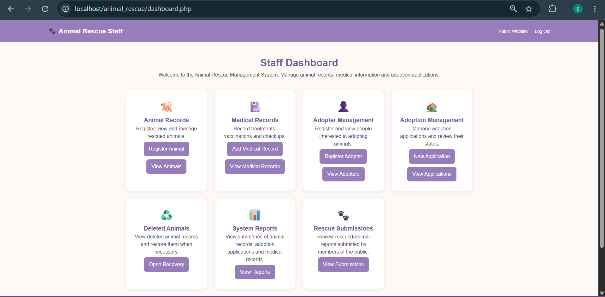

# Animal Rescue and Adoption Management System

My DBIT final project.

## Description
A web-based system designed to help animal shelters manage rescued animals, medical records, adopters and adoption applications.

## Technologies
- PHP
- MySQL
- HTML
- CSS

## My Role
Designed, developed, tested and documented the system as part of my DBIT final project.
## Screenshot

